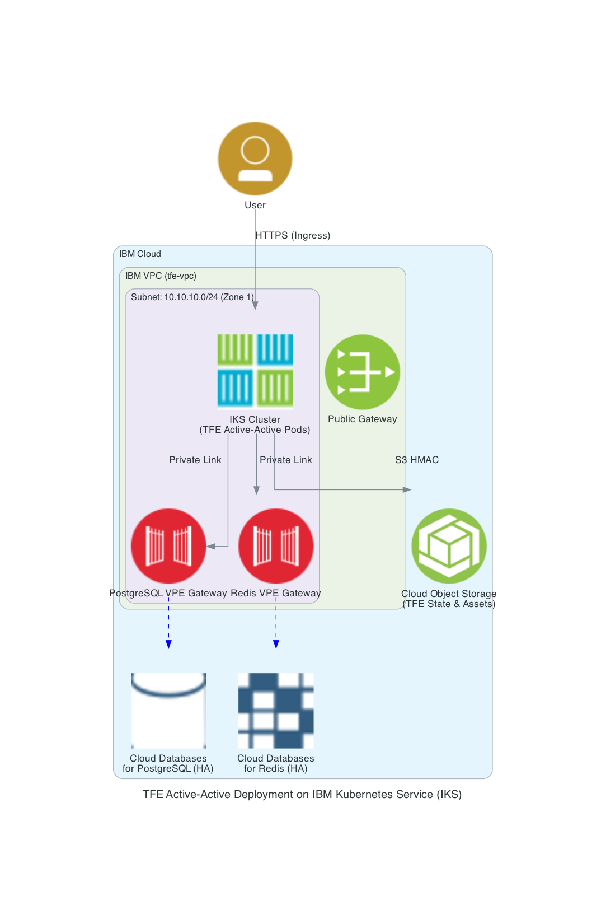

# Terraform Enterprise (TFE) Active-Active on IBM Kubernetes Service (IKS)

This repository provides Terraform configurations to provision the IBM Cloud infrastructure prerequisites and deploy a highly available, active-active Terraform Enterprise (TFE) instance (Flexible Deployment Options - FDO) on an IBM Kubernetes Service (IKS) cluster. 

In this active-active architecture, state and assets are stored in external database and object storage systems to ensure full high-availability across the environment.

---

## Architecture Overview

We provision a secure, enterprise-grade architecture according to the following design:

1. **Virtual Private Cloud (VPC)**: Created in a single zone (e.g., `eu-de-1`) with a custom VPC Address Prefix and a Subnet (`10.10.10.0/24`). A Public Gateway is attached to the subnet for outbound internet traffic (required for downloading container images and Helm charts).
2. **IBM Kubernetes Service (IKS) VPC Cluster**: A VPC-based Kubernetes cluster deployed in the VPC subnet. It features a default worker pool and a secondary dedicated worker pool (`tfe-agent`).
3. **IBM Cloud Databases for PostgreSQL**: A standard managed PostgreSQL cluster (v16) for TFE's primary data store. Connectivity is private-only and secured via a Virtual Private Endpoint (VPE) Gateway.
4. **IBM Cloud Databases for Redis**: A managed Redis cluster (v8.2) used as TFE's external active-active cache. Private connectivity is secured via a Virtual Private Endpoint (VPE) Gateway.
5. **IBM Cloud Object Storage (COS)**: An object storage instance and a standard bucket utilizing S3-compatible HMAC credentials for storing TFE's state files, run assets, and application data.
6. **Ingress and Certificates**: Built-in Traefik (`public-iks-traefik`) is used for routing inbound traffic. The setup automatically copies the cluster's wildcard TLS certificate from the `default` namespace to the TFE namespace to secure the ingress domain.

Below is the diagram of the infrastructure:


---

## Prerequisites

Before deploying, ensure you have the following tools and accounts:

1. **IBM Cloud Account** with permissions to manage VPC, IKS, Cloud Databases (PostgreSQL & Redis), and Cloud Object Storage.
2. **IBM Cloud API Key**: To authenticate the Terraform provider make sure to have a valid API token
3. **Terraform CLI**: Installed on your system ([How to install Terraform](https://learn.hashicorp.com/tutorials/terraform/install-cli)).
4. **kubectl**: Available on your system ([kubectl Installation](https://kubernetes.io/docs/tasks/tools/)).
5. **helm**: Available on your system ([Helm Installation](https://helm.sh/docs/intro/install/)).

---

## Deployment Steps

This repository is split into two distinct stages of deployment:
1. `infra/`: Sets up all necessary IBM Cloud resources and infrastructure prerequisites.
2. `tfe/`: Connects to the created infrastructure and deploys TFE via Helm.

### Step 1: Provision the Infrastructure Prerequisites

In this step, we provision the IBM Cloud resource group, VPC, subnets, IKS cluster, Databases for PostgreSQL & Redis (with their private VPEs), and COS.

1. Navigate to the `./infra` directory:
   ```bash
   cd infra
   ```
2. Create or customize `variables.auto.tfvars` with the following variables:
   ```hcl
   environment_prefix   = "tfe-ibm"                # Prefix used for naming all generated resources
   ibmcloud_api_key     = "your_ibm_cloud_api_key" # Optional if IC_API_KEY environment variable is set
   region               = "eu-de"                  # Target region

   # Optional customizations (defaults shown below):
   # postgres_members             = 2              # Node count (2 for dev/test, 3 for HA production)
   # postgres_deletion_protection = false          # Disable protection for easy teardown during testing
   # redis_deletion_protection    = false          # Disable protection for easy teardown during testing
   # redis_version                 = "8.2"
   ```
3. Initialize the directory:
   ```bash
   terraform init
   ```
4. Apply the configuration:
   ```bash
   terraform apply
   ```

Upon completion, Terraform will output the configuration values and **automatically write your cluster's administrative kubeconfig** locally to `./kubeconfig/config.yaml`. This file is referenced in the next stage for secure Kubernetes access.

---

### Step 2: Deploy Terraform Enterprise (TFE)

With the infrastructure running and the kubeconfig securely saved to disk, you can deploy the TFE Helm release. This step automatically configures database tables, PostgreSQL extensions, TLS certs, and mounts, and deploys the Helm chart.

1. Navigate to the `./tfe` directory:
   ```bash
   cd ../tfe
   ```
2. Create or customize `variables.auto.tfvars` with the following variables:
   ```hcl
   # Hostname label of TFE (placed below the IKS ingress subdomain)
   route53_subdomain       = "tfe1"
   
   # TFE Configuration
   replica_count           = 1
   tfe_raw_license         = "your_raw_tfe_license_text_here"
   release_sequence        = "2.1.0"
   tfe_helm_chart_version  = "v2.0.8"
   tfe_encryption_password = "YourTFEEncryptionPassword_123!"
   
   # Initial TFE Admin Credentials
   admin_username          = "admin"
   admin_email             = "your-email@company.com"
   admin_password          = "YourSecureAdminPassword#1"
   ```
3. Initialize the directory:
   ```bash
   terraform init
   ```
4. Deploy the application:
   ```bash
   terraform apply
   ```

#### What happens during this deployment?
- Reads `./infra/terraform.tfstate` via a `terraform_remote_state` data block to fetch database hostnames, credentials, COS endpoints, and cluster details.
- Copies the cluster's default wildcard TLS certificate from the `default` namespace into the `terraform-enterprise` namespace.
- Launches a Kubernetes Job inside the cluster to privately connect to PostgreSQL and enable the required extensions (`citext`, `hstore`, `pg_stat_statements`, `uuid-ossp`) in the `ibm_extension` schema before starting TFE.
- Deploys the official `terraform-enterprise` Helm chart using custom overrides specified in `overrides.yaml`.

---

### Step 3: Configure the TFE Admin Account

After the TFE Helm deployment completes, Terraform outputs the application URL and the path to a post-install script. Run this script to finish the installation, which waits for TFE to come online, registers your administrative user, and creates a test organization:

1. Execute the command provided in the `tfe_execute_script_to_create_user_admin` output. It has the following format:
   ```bash
   ./scripts/configure_tfe.sh <TFE_FQDN> <ADMIN_EMAIL> <ADMIN_USERNAME> <ADMIN_PASSWORD>
   ```
2. Once the script says `"Script finished"`, you are ready to log in!
3. Access your new active-active TFE instance at:
   - **TFE Console**: `https://<route53_subdomain>.<iks_ingress_hostname>`
   - **TFE Admin Console**: `https://admin-<route53_subdomain>.<iks_ingress_hostname>`
